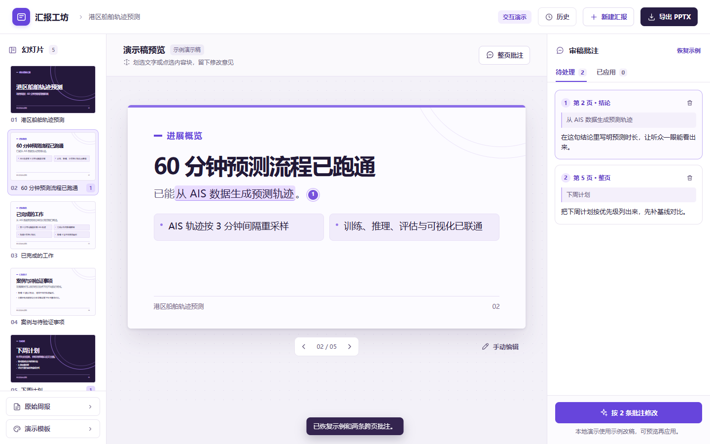

# 汇报工坊 · 周报转 PPT

粘贴周报，生成演示稿，跨页批注后批量改稿，最后下载可编辑的 PowerPoint 文件。首屏包含 5 页示例和 2 条待处理批注。



## 本地预览

需要 Node.js 22.12+。

```sh
npm ci
npm run dev
```

在预览中划选文字、点选内容块或点击「整页批注」。跨页添加批注后，点击「按批注修改」，确认建议再逐条或统一应用。点击「原始周报」可替换材料并生成新稿。

- **汇报历史**保存每份周报、演示稿、批注和已应用的模板。浏览器演示保存在当前浏览器，Anna 版使用账号下的应用存储。
- **演示模板**支持 `.pptx` 和 `.potx`。选择文件后，点「应用模板」，将配色、纯色背景和字体同步到预览及 PPTX 导出。幻灯片内容使用汇报工坊的版式排版。

本地模式使用规则整理和预置改稿，不消耗 Anna 额度。添加自定义文字批注时，可以直接写 `改成「新文字」`，也可以在建议列表填写修改稿。线上接入 Anna 后，生成与批量改稿各调用一次模型。

运行 `npm run build:offline` 可生成 `offline/周报转PPT.html`。在文件资源管理器里双击该文件即可使用，也可以将其拖进 Chrome 或 Edge，无需启动本地服务。

## Anna 构建和调试

```sh
npm run build
npm run validate
npx anna-app login --host https://staging.anna.partners
```

在 staging 验证邮箱，并在 Developer Console 激活开发者权限和设置 handle。构建输出在 `bundle/`。App 在 Anna 窗口中连接官方 SDK，通过 `llm.complete` 生成幻灯片 JSON。演示文稿由 PptxGenJS 在浏览器中生成。改页、排版和导出无需再次调用模型。

登录并创建 staging 草稿后，安装 [uv](https://docs.astral.sh/uv/getting-started/installation/)，再用 `npm run anna:dev -- --slug weekly-slides --llm-account https://staging.anna.partners` 调试真实模型。也可以直接在开发者控制台安装草稿并验证。真实调用会消耗账号额度。

### 额度与数据

- 点击生成或批量改稿时，材料和相关内容通过 Anna 模型接口处理。每次操作发送一次模型请求，并按页数或批注数量设置输出上限。界面显示 Anna 返回的实际额度消耗。
- Anna 版使用当前账号的应用存储保存汇报和批注。模板文件在浏览器中解析，保存的是提取的主题设置。

## Staging 发布

1. 构建并验证后，用 `npx anna-app apps push --account https://staging.anna.partners` 上传草稿。
2. 在 staging 安装草稿，用示例材料生成 5 页初稿。在不同页各标一处，一次提交并检查修改建议。应用后重新从历史打开，导出并在 PowerPoint 或 WPS 中验证。核对两次操作的额度消耗。
3. 用 `npx anna-app apps cut 0.1.0 --account https://staging.anna.partners` 创建版本。核对商店图标、截图和源代码链接后提交审核。获批后发布，并确认其他账号能发现、安装和打开应用。

应用名称为「汇报工坊 · 周报转 PPT」。应用 slug 为 `weekly-slides`，在商店中带开发者的 `@handle` 前缀。

### Staging 实测

2026 年 11 月 21 日，通过 Anna CLI 开发环境连接 staging 的模型和应用存储，使用设备监控周报生成 5 页演示稿。对第 2 页标题和第 5 页内容提交一批修改，确认应用后可从历史恢复。导出的 PPTX 在 PowerPoint 中打开，包含两处修改。生成消耗约 0.08966 额度，批量改稿消耗约 0.08879 额度。

- [Anna 开发文档](https://staging.anna.partners/developers)
- [Anna 发布文档](https://staging.anna.partners/developers/apps/app-publish.md)
